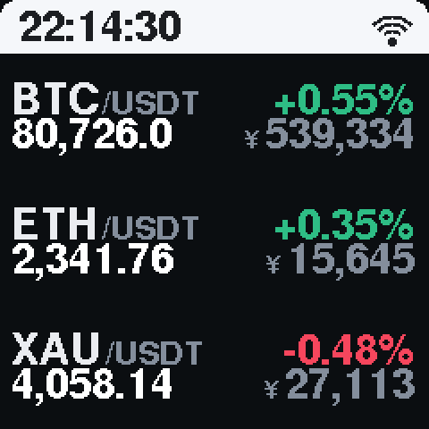
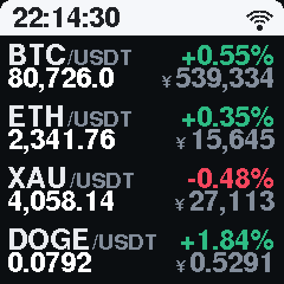
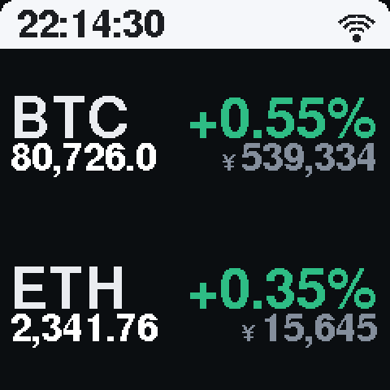

# CryptoDash — 给桌面小盒子的行情数据服务

自己搭一套行情服务，跑在路由器的 Docker 里，桌面小盒子（ESP8266 摆件，如 GeekMagic HelloCubic Lite）连过来取数据显示。
**不依赖任何卖家服务器**，所以卖家跑路、接口挂掉都不会再白屏。

> 行情默认取 **币安 U 本位永续合约价**（`fapi.binance.com`，接口返回的 `market` 字段会是 `futures`）。
> 币安连不上时自动降级到 **OKX 永续**，仍是合约价；再不行才退到现货源并标注 `market: spot`。
> 想确认当前用的是哪个源，看 `/health` 里的 `source` 和 `market`。

## 屏幕长什么样

240×240 屏幕，仿币安 App 的行情表：顶部时间条（走时来自服务端，盒子不跑 NTP）+ WiFi 图标，
每行左上「币种 + /USDT」、右上涨跌幅，左下 USDT 价、右下人民币价。

| 3 行（默认） | 4 行 | 2 行 + 大字号 |
|---|---|---|
|  |  |  |

行数、主/次字号、涨跌配色、是否显示人民币都在网页面板里改，改完 1~2 秒屏幕跟着变，不用重刷固件。

---

## 0. 先判断你的盒子是哪种白屏

| 现象 | 说明 | 对策 |
|---|---|---|
| 背光还亮、屏幕全白/全黑，时间也不走 | 固件卡在取数据这一步 | 本文方案有效 |
| 时间正常走，只有行情区空白 | 只挂了行情接口 | 本文方案有效，最省事 |
| 完全不亮、摸上去不热 | 供电或屏排线问题 | 换 5V/2A 电源、检查线 |

本文针对前两种。判断方法：**看屏幕上时间有没有在跳**。

---

## 1. 目录结构

```
crypto-dash/
├── install.sh              一键部署脚本（推荐）
├── server.js               服务本体（零依赖，Node 18+）
├── binance_ws.js           币安合约 WebSocket 数据源
├── public/                 控制台网页
├── docs/                   屏幕效果图（README 里引用）
├── Dockerfile
├── docker-compose.yml
└── firmware/
    ├── final14/            ESP8266 固件（当前版本，Arduino 工程）
    │   ├── final14.ino     主程序：取数、排版、配网、OTA、网页配置
    │   ├── icons.h         32×32 币种图标（RGB565，PROGMEM）
    │   ├── glyphs.h        中文/¥ 点阵字模（矢量字体只有 ASCII）
    │   └── QR_WIFI.h       配网二维码 + 中文提示位图
    └── tools/genqr.py      重新生成上面那些位图
```

---

## 2. 在路由器 Docker 里跑起来

### 2.1 把文件传上去

在电脑上执行（把 IP 换成你路由器）：

```bash
scp -r crypto-dash root@192.168.1.1:/root/
```

或者用 iStoreOS 的「文件管理」直接把整个文件夹拖进 `/root/`。

### 2.2 启动（一条命令）

SSH 登录路由器：

```bash
cd /root/crypto-dash
sh install.sh
```

脚本会自己检查 Docker、建镜像、起容器，最后把**盒子该填的地址**直接打印出来，长这样：

```
 >>> 盒子配网页面里填这个地址：
     http://192.168.1.1:8080/api/device
```

复制它，进第 3 节。

<details>
<summary>想手动来 / 想用 compose 的话（点开）</summary>

```bash
cd /root/crypto-dash
docker compose up -d --build
docker compose logs -f      # 看到 listening on :8080 就成了
```

不用 compose 插件也行：

```bash
docker build -t crypto-dash:1.0.0 .
docker run -d --name crypto-dash --restart unless-stopped \
  -p 8080:8080 -v /root/crypto-dash/data:/app/data \
  -e SYMBOLS="BTCUSDT,ETHUSDT,ETCUSDT" \
  -e PROVIDERS="binancefutures,okxswap,binance,okx,gate,mexc,coingecko" \
  crypto-dash:1.0.0
```

</details>

### 2.3 验证

浏览器打开 `http://192.168.1.1:8080/`，能看到实时价格的卡片就 OK。
再打开 `http://192.168.1.1:8080/preview`，那就是你盒子屏上应该是的样子。

点页面上的 **`/health`**，`"ok": true` 且 `providers` 里有 `ok: true` 的源，说明数据通了。
如果全是失败，看第 7 节「行情拿不到」。

---

## 3. 让盒子连上（三条路线，从省事到费事）

### 路线 A：固件里能改服务器地址（最省事，先试这个）

这类 DIY 摆件通常长按按键（或首次上电）会出现配网页面，页面上除了 WiFi 账号密码，
往往还有个 **「服务器地址 / API 地址 / 自定义接口」** 的输入框。

1. 进入配网页面（长按背面按键 3 秒，或手机连它发出来的热点，访问 `192.168.4.1`）
2. 服务器地址填：`http://192.168.1.1:8080/api/device`
3. 保存 → 盒子重启

能显示就结束了。不同固件的地址栏要的格式不一样，按顺序试：

| 它要的 | 你填 |
|---|---|
| 完整地址（带路径） | `http://192.168.1.1:8080/api/device` |
| 带 http 的根地址 | `http://192.168.1.1:8080` |
| 只给 IP 或 host:port | `192.168.1.1:8080` |

> 配网页面里**如果没有地址栏**，只有 WiFi 名和密码，说明固件写死了域名 —— 这时候别硬试，
> 直接看路线 B，不用刷机。

填完还是白屏？看 `http://192.168.1.1:8080/probe`，盒子发过来的请求会列在那里。

### 路线 B：改不了地址，用 DNS 劫持（不用刷机）

盒子固件里写死了某个域名（比如卖家自己的 API 域名），我们用路由器把这个域名
指到内网，让它以为还在访问原服务器。**不需要拆机、不需要刷固件。**

**第 1 步：查它请求哪个域名**

SSH 到路由器，打开 dnsmasq 查询日志：

```bash
uci set dhcp.@dnsmasq[0].logqueries='1'
uci commit dhcp
/etc/init.d/dnsmasq restart
logread -f | grep -i query
```

然后给盒子断电重启。日志里会刷出一串域名，找到那个不像常见大厂（不是 apple.com、
mi.com、ntp.org 这种）、名字像 `api.xxx.com` / `iot.xxx.cn` 的，就是它。

嫌日志太吵，可以直接抓包（更直观，能看到 IP 和端口）：

```bash
opkg update && opkg install tcpdump
tcpdump -i br-lan -n host 192.168.1.123      # 换成盒子的 IP
```

**第 2 步：把这个域名指到路由器自己**

```bash
uci add_list dhcp.@dnsmasq[0].address='/api.xxx.com/192.168.1.1'
uci commit dhcp
/etc/init.d/dnsmasq restart
```

> 注意：容器端口映射用的是 `-p 8080:8080`，如果盒子请求的是 80 端口，
> 就把 compose 里改成 `"80:80"`，并加一行 `PORT: "80"`，然后 `docker compose up -d`。

**第 3 步：看它请求了什么**

盒子重启后，打开 `http://192.168.1.1:8080/probe`，里面会列出盒子发过来的每一个请求：
方法、路径、Host、User-Agent。程序已经自动回了一份"什么字段都有"的 JSON。

- **能显示了** → 搞定。
- **还白屏** → 把 `/probe` 这个页面截图给我，我按真实路径和格式把返回体改成它要的样子。
  这一步基本都能成，因为格式是可以照着原厂接口反推的。

**一个坑**：如果抓包看到它连的是 `443` 端口（HTTPS），劫持会碰到证书校验。
廉价固件大多用的是"不校验证书"的写法，能骗过去；如果它真做了证书校验，
那就只剩路线 C。**先抓包看一眼端口，是 80 就走这条路。**

### 路线 C：刷自己的固件（最彻底）

需要拆机确认芯片（ESP32 / ESP32-C3 / ESP8266），用串口（TX/RX/GND + 3.3V）刷。
本仓库的 `firmware/final14/` 就是一套现成固件（ESP8266 + ST7789 240×240），已经带：

- 网页配网（扫码进 `192.168.4.1`）、网页改币种/行数/字号/配色
- 远程改「盒子连哪台行情服务」：`GET /setapi?api=192.168.1.10:8095`
- 浏览器 OTA 升级：`curl -F "firmware=@final14.ino.bin" http://<盒子IP>/update`

编译（装好 esp8266 core 和 Adafruit 的 GFX / ST7735_ST7789 两个库）：

```bash
arduino-cli compile -b "esp8266:esp8266:generic:eesz=4M" --output-dir build firmware/final14
```

固件里出厂 WiFi 是空的，所以第一次开机会自己开热点 **CryptoBox（密码 12345678）**，
手机连上去打开 `192.168.4.1` 填好 WiFi 和服务地址即可。想从源码写死也行，改
`final14.ino` 里的 `cfgDefaults()`；但更推荐走配网，密码就不会进 git。

引脚/屏幕型号不一样的话，改文件开头的 `PIN_DC / PIN_RST / PIN_BL` 和 `setRotation()` 那几行。

> 这条路的成本是"搞清引脚"，好处是以后想显示什么就显示什么，不再受卖家限制。

---

## 4. 接口一览

| 路径 | 用途 |
|---|---|
| `/api/device` | **推荐给固件用**。`{time, date, items:[{label, priceText, changeText, up}]}` |
| `/api/quotes` | 同上（别名） |
| `/api/quotes/flat` | 扁平字段：`btc_price` / `btc_change` / `eth_price` … |
| `/api/price?symbol=BTCUSDT` | 单币种 |
| `/api/rate` | 当前汇率 `1 USDT = ? CNY`，含来源与更新时间 |
| `/api/v3/ticker/24hr?symbol=BTCUSDT` | **Binance 官方格式**，老固件改个域名就能用 |
| `/api/v5/market/tickers` | **OKX 官方格式** |
| `/api/stocks` | A 股（腾讯行情） |
| `/api/time` | 时间，给纯时钟固件用 |
| `/api/tiny` | 屏幕专用精简版：`{t, fb, fs, d:[{l,p,y,c,u,k}]}`（时间/字号/行数据） |
| `/api/config` | 读/写显示配置：币种、行数、字号、配色、人民币、汇率 |
| `/api/box` | 读写「盒子连哪台服务」，POST 后主动推给盒子 |
| `/admin` | 可视化后台：左边调参数，右边 240×240 实时预览 |
| `/health` | 自检：数据源状态、距今多久 |
| `/probe` | 设备请求探测页（反推固件用） |
| 其他任意路径 | 记录 + 返回一份"万能 JSON" |

`/api/device` 实际返回：

```json
{
  "ok": true, "ts": 1793176805, "time": "16:40:05", "date": "2026-10-28",
  "source": "binancefutures", "market": "futures",
  "items": [
    { "symbol":"BTCUSDT", "label":"BTC/USDT", "price":81676.5,
      "priceText":"81676.5", "cny":545682.3, "cnyText":"545,682",
      "changeText":"+2.34%", "up":true,
      "high":81820, "low":79505, "volume":3829.9, "market":"futures" }
  ]
}
```

`priceText` / `cnyText` / `changeText` 已经格式化好，固件直接画字就行，不用自己算小数位。

### 人民币价格怎么来的

服务端维护一个 `USDT→CNY` 汇率，每 10 分钟自动联网更新（`open.er-api.com` → `frankfurter.app` → `exchangerate.host` 依次尝试，全挂就沿用上次的值，最差用 7.1 兜底）。
想锁死某个值（比如按 C2C 实际成交价），在 `/admin` 的「人民币汇率」里填 `7.30` 并保存，之后不再联网；清空即恢复自动。

`GET /api/rate` 可以看到当前值、来源（`er-api` / `manual` / `default`）和多久之前更新的。

---

## 4.5 后台设置页 `http://<路由器IP>:8095/admin`

所有能改的东西都在这一个页面里，左边改、右边是 240×240 的实时预览（跟屏上同一套坐标算），
点「保存并应用」后盒子走长连接立刻拿到新配置，**不用重启容器、不用重新刷固件**。

| 能改的 | 效果 |
|---|---|
| 屏幕设备（盒子） | 改盒子**连哪个行情服务**，也就是 `192.168.100.2:8095` 这一项：读它当前地址 / 一键推送新地址，盒子立刻重连 |
| 币种（最多 4 个） | 可视化增删 + ↑↓ 排序，带 logo 预览；填裸名即可，服务端自动补 `USDT` |
| 人民币价格 | 每行**右下角**显示 ¥ 金额；关掉就换成 24h 成交额 |
| 24h 成交额 | 只在关掉人民币时占右下角，如「880亿」 |
| 涨跌配色 | 绿涨红跌（币安/国际）↔ 红涨绿跌（A 股习惯）一键切 |
| 屏幕行数 | 1~4 行 |
| 主字号 / 次字号 | 各 4 档（小 9pt / 中 12pt / 大 18pt / 特大 24pt）。主=币种名+涨跌幅，次=价格+人民币；改完 1 秒内屏幕跟着变 |
| 合并推送间隔 | 80~800 ms，越小越跟手 |
| 人民币汇率 | 自动联网 / 手动锁定（按 C2C 实际成交价） |
| 行情接口地址 | 页面最下方独立卡片（常显，不用展开）：WS 主通道 / REST 兜底 / 订阅流 / 额外请求头，附两个币安域名预设和「当前生效」提示 |

### 改「盒子连哪个服务」（新增）

后台第一张卡片「屏幕设备（盒子）」就是干这个的：

- 盒子 IP：服务端从它自己的取数请求里**自动认出来**（ESP 的请求没有浏览器 UA），不用手填
- 要连的地址：读的是盒子 `/status` 里的 `api` 字段，点「填成本页地址」可一键填成当前后台地址
- 点「推送给盒子」→ 服务端请求 `http://<盒子IP>/setapi?api=host:port`（固件 final13 起支持），
  盒子存 EEPROM 后**立刻断开旧长连接用新地址重连**，不用重启、不用刷固件

```bash
# 手动调用也一样
curl "http://192.168.100.106/setapi?api=192.168.100.2:8095"
# {"ok":true,"api":"192.168.100.2:8095"}   非法值返回 400 + {"ok":false,...}
```

服务端接口：`GET /api/box` 读它现在的地址与在线状态，`POST /api/box` `{"ip","api"}` 推送。
地址填错盒子会取不到数（屏幕停住），这时打开 `http://<盒子IP>/syms` 手动改回来即可。

### 屏幕是怎么"跟着变"的

服务端下发的每行多了两个字段，盒子照着画就行，所以改配置不用动固件：

```json
{"l":"BTC/USDT","p":"80,591.9","y":"538,438","v":"892","c":"+0.58%","u":1,"k":1}
```

- `u` = 涨跌方向（1 涨 / 0 平 / -1 跌）
- `k` = **显示颜色**（1 绿 / 0 平 / -1 红），服务端已经按「绿涨红跌 / 红涨绿跌」换算好
- `y` 为空 = 不显示人民币；`v` 为空 = 不显示成交额

对应接口 `GET/POST /api/config`：

```json
{ "symbols":"BTC,ETH,XAU", "showCny":true, "showVol":true,
  "colorMode":"green", "maxRows":3, "pushMs":80, "cnyRate":"",
  "fontBig":1, "fontSmall":1 }
```

`colorMode` 取 `green`（绿涨红跌）或 `red`（红涨绿跌）；`cnyRate` 留空即自动取汇率。
`fontBig` / `fontSmall` 是**屏幕字号**档位 0~3（0=小 9pt、1=中 12pt、2=大 18pt、3=特大 24pt）：
`fontBig` 管币种名与涨跌幅，`fontSmall` 管价格与人民币金额。它们随每条推送的 `fb` / `fs` 字段下发，
盒子收到就整套重排，不用重启、不用重刷固件；行数多或字号太大时盒子会自动降一档到放得下，不会叠字。
配置会写进 `data/config.json`，断电重启也保留。

---

## 5. 配置项（改 `docker-compose.yml` 的 environment）

| 变量 | 默认 | 说明 |
|---|---|---|
| `SYMBOLS` | `BTCUSDT,ETHUSDT,ETCUSDT` | 要显示的币种，交易对格式 |
| `STOCKS` | `sz000001,sh601318` | A 股代码，`sh` 沪 / `sz` 深，留空不显示 |
| `PROVIDERS` | `binancefutures,okxswap,binance,okx,gate,mexc,coingecko` | 行情源优先级，第一位币安合约价，第二位 OKX 永续 |
| `REFRESH_MS` | `15000` | 抓取间隔，别低于 5000 |
| `PORT` | `8080` | 盒子要 80 就改成 80 |
| `NETWORK` | `host` | 网络模式。**建议保持 host**，见下面 FAQ 里的 DNS 那条 |
| `BASE_IMAGE` | `node:22-alpine` | 路由器上已有 node 镜像时填它的名字，省去联网拉取 |
| `TZ` | `Asia/Shanghai` | 时区，影响屏上时间 |

改完 `docker compose up -d` 生效。

---

## 6. 常用运维

```bash
docker compose logs -f --tail 50     # 看日志
docker compose restart               # 重启
docker compose down && docker compose up -d --build   # 改完代码重建
curl -s http://127.0.0.1:8080/health | grep -o '"ok":true'
```

请求日志落在 `./data/requests.log`，超过 2MB 自动清空。

---

## 7. 常见问题

**Q：容器起来了，但 `/health` 里 `quotes: 0`、错误是 `fetch failed` 或 `getaddrinfo` 失败？**
十有八九是**容器 DNS 解析不了域名**。docker 默认给容器下发 `8.8.8.8`，在国内网络下这个地址
经常被拦（表现为 `nslookup: write to '8.8.8.8': Connection refused`），而路由器自己是用
`127.0.0.1` 的 dnsmasq + 代理出去的，所以"路由器能 curl，容器不能"。

诊断：
```bash
docker exec crypto-dash nslookup fapi.binance.com
```

解决：用 host 网络，让容器直接沿用路由器的 DNS 和代理通道：
```bash
docker run ... --network host ...      # install.sh 里 NETWORK=host 就是干这个的
```
坚持用 bridge 的话，至少加 `--dns 192.168.100.2`（换成你路由器 LAN IP），
但如果你路由器上跑着 mihomo/OpenClash 的 TUN 模式，bridge 出去的流量不一定被代理接管，
还是 host 最稳。

**Q：`/health` 里 source 是 `okxswap` 而不是 `binancefutures`？**
说明币安 `fapi.binance.com` 从你路由器出去不通，已经自动降级到 OKX 永续了——**价格还是合约价，屏上照常显示，不用管**。
如果两个都失败（`lastError` 有内容），再处理：
1. 换源：`PROVIDERS` 里把 `gate` 或 `mexc` 提前（注意这两个是现货价）；
2. 路由器上有代理（OpenClash / PassWall）时，把 compose 的 `network_mode` 改成 `host`，
   并在 `ports` 段留空——走宿主机网络通常能吃到代理；
3. 在你另一台能出去的机器上跑同样镜像，盒子指向那台机器的 IP。

**Q：`docker build` 报 `no matching manifest`？**
路由器是 mips 架构，Node 官方镜像不支持。确认下 `uname -m`：
`aarch64` / `armv7l` 没问题，`mips` 就换成跑在 NAS 或小主机上。

**Q：容器起来了但盒子访问不到？**
路由器防火墙拦了 LAN 到 Docker 的转发，或者你映射到了 `127.0.0.1`。
用 `-p 8080:8080`（不要写 `127.0.0.1:8080:8080`），然后在手机上访问
`http://192.168.1.1:8080/` 验证一下先。

**Q：盒子上时间不对？**
容器 `TZ=Asia/Shanghai` 已设好，时间由容器生成，不依赖盒子自己的 NTP。

**Q：会被行情源限频吗？**
15 秒一次、3 个币种，远低于各家的限制。别把 `REFRESH_MS` 调到 1 秒。

---

## 8. 下一步

盒子连上后如果还是白屏，**打开 `/probe` 截图发我**，上面有它真实的请求路径和 UA。
我按那个格式改返回体，通常一轮就能对上。

---

## 9. 实时行情：数据链路与「换接口」

### 现在的链路

```
币安 U 本位合约 WebSocket (fstream.binancefuture.com)
   │  <sym>@aggTrade  逐笔成交（最新价，10~50ms 推一次）
   │  <sym>@ticker     1000ms（24h 涨跌幅/高低/量）
   ▼
路由器 crypto-dash（常驻内存快照，不算请求才更新）
   │  SSE /api/stream，合并窗口 80ms
   ▼
盒子 ESP8266（长连接常驻，收到即刷屏；断线自动重连，转 HTTP 轮询兜底）
```

实测：**币安成交 → 屏幕变化约 250ms**。其中大部分是「币安 → 路由器」的跨境网络往返，
合并窗口只占 80ms。再往下压收益很小，反而会让 ESP8266 的 SPI 写屏跟不上。

盒子状态里 `sse:1` 表示长连接正常，`pushed` 是已接收的推送条数。

### 换接口的两种方式

**方式一：网页（推荐）**

浏览器打开 `http://192.168.100.2:8095/admin`，直接改地址、订阅流、币种，点「保存并重连」，
立即生效，不用重启容器。

**方式二：改文件**

```sh
vi /root/crypto-dash/data/config.json
docker restart crypto-dash
```

`data/config.json` 字段说明：

| 字段 | 作用 | 默认 |
|---|---|---|
| `wsUrl` | 行情 WebSocket 地址，程序自动拼 `?streams=` | `wss://fstream.binancefuture.com/stream` |
| `streams` | 订阅的流，逗号分隔 | `aggTrade,ticker` |
| `restUrl` | REST 兜底地址（WS 断开时用） | `https://fapi.binance.com/fapi/v1/ticker/24hr` |
| `headers` | 额外请求头，格式 `Key: Value\|Key2: Value2`，走代理时需要 | 空 |
| `symbols` | 合约交易对，逗号分隔，最多 8 个 | `BTCUSDT,ETHUSDT,ETCUSDT` |
| `pushMs` | 合并推送窗口（毫秒），越小越实时 | `80` |
| `restEverySec` | REST 兜底轮询间隔秒数 | `30` |

> **注意域名**：`fstream.binance.com` 在部分网络下能握手但**会被静默丢弃数据帧**（本项目实测如此），
> 所以默认用 `fstream.binancefuture.com`。REST 反之，`fapi.binance.com` 可用而 `fapi.binancefuture.com` 不通。
> 换网络环境后如果没数据，先看 `/api/latency` 里 `msgs` 是否在涨。

### 第三方对接 / 自定义数据源

服务端对盒子只用两种接口，任何人想接自己的数据源，只要实现这两种即可：

**1. SSE 推送（主通道）** `GET /api/stream`

```
HTTP/1.1 200
Content-Type: text/event-stream
Connection: close            ← 不用 chunked，ESP8266 可直接按行读

retry: 2000

data: {"t":"21:09:14","s":"binance-futures-ws","r":6.68,"a":248,"d":[{"l":"BTC/USDT","p":"80,686.2","y":"538,976","v":"880","c":"+0.64%","u":1}]}

: hb                        ← 15 秒一次心跳

```

`r` = 当前汇率（USDT→CNY），`a` = 数据年龄（毫秒），`d[].l` 币种对、`p` 价格字符串（带千分位）、`y` 人民币价格字符串、`v` 24h 成交额（单位「亿」，中文「亿」由固件点阵补上）、`c` 涨跌幅字符串、`u` 1 涨 0 平 -1 跌。

**2. 轮询（兜底）** `GET /api/tiny` — 同样的 JSON 结构，一次性返回。

**3. 运行时改币种** `GET /api/symbols?set=BTC,ETH,SOL` — 裸币种名会自动补 `USDT`。

**4. 配置读写** `GET /api/config` 查看，`POST /api/config` 传 JSON 局部更新。

**5. 延迟自检** `GET /api/latency` — `msgs` 是 WS 收到的消息数，`minAgeMs` 是最新一笔的年龄。
